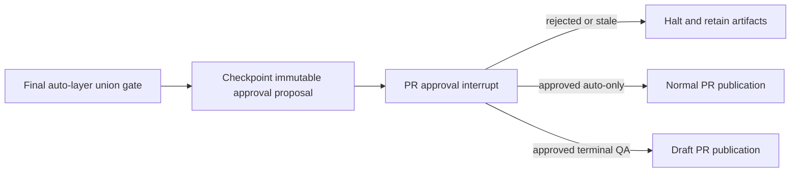

# Exact-candidate PR approval

S13 adds the same human approval boundary to normal and terminal-QA publication.
The [implementation checklist](reviews/heavy-prd-progress.md) and
[acceptance evidence](reviews/heavy-prd-evidence.md) track verification and the
remaining release gates. S14 adds [remote reconciliation and recovery](heavy-prd-publication.md).

## Contract and routing

An execution contract may have no human unit or one terminal human unit, exclusively
human-gated, transitively dependent on every auto unit. A human-only contract,
mid-DAG human unit, sibling QA or mixed human/auto layers fails semantic validation
before a paid call. Structural Contract-v1 parsing remains compatible with archived
documents; `validate` and execution apply the stricter execution rules.

Every auto unit runs through its normal implementation, exact-candidate gate and
review policy. The human unit has no model plan or implementation. Both scheduling
shapes then use:



`--approve plan` never authorizes either publication path. `--approve plan,pr`
approves both gates. Neither path merges a PR. A blocked or unavailable review
halts earlier; it cannot be converted to a draft to bypass review policy.

## What a PR decision binds

The deterministic `prepare_pr_approval` node persists and checkpoints the proposal
before `approve_pr` interrupts. The payload includes run ID, request round, exact
clean candidate commit/tree, owned branch, saved origin/base, draft intent, pending
QA unit, each auto unit's candidate and gate/review receipt references, final gate
receipt and current review status. The terminal displays the exact SHA, draft
intent, receipt IDs/layers/status and pending QA check; `--json` retains the complete
payload where supported by the gate renderer.

The candidate must equal the known completed execution tip. An unknown additional
commit cannot reuse the approval, even if independently tested. Workspace path,
branch, origin and base must agree with the immutable run context. Missing, stale
or changed proposal/decision/patch evidence refuses publication. Only a boolean
positive decision authorizes it. A structured decision may additionally supply the
run ID, candidate, draft and request round; supplied identities must match.

The graph wrapper and publisher both check approval before PR summary generation.
The publisher checks again immediately before push and before `gh pr create`.
Push names the approved object explicitly as `<SHA>:refs/heads/<run-branch>` and
never force-pushes. S14 additionally checks fetch and push endpoint identity and
validates actual remote branch/PR identity before publication, including after a
long summary call. Its reconciliation requires an exact run/candidate body marker.

## Retained evidence and diff preview

Artifacts live under the existing private run directory:

```text
publication/
  approval-<round>-proposal.json
  approval-<round>-decision.json
  diffs/<identity>.patch
```

Each proposal and decision has critical journal intent/outcome evidence. Existing
round files are immutable. Recovery capture includes the publication artifacts.
The full cumulative binary/rename patch is written by Git directly to a private
artifact, independently of capped command stdout. `[hitl].pr_diff_max_bytes` bounds
only the displayed preview, with an explicit truncation marker. Zero disables the
optional preview. The complete patch manifest/hash remains recorded when enabled.

## Restart and migration

After PR rejection, explicit `blacksmith resume --thread-id <id> --approve pr`
creates the next request round and presents a fresh interrupt under the saved
inputs and consumed budgets. It preserves the original negative decision. No
completed plan/implementation/review call is replayed merely to ask again.

If the process exits after a complete recorded decision but before the graph
checkpoint, resume reuses that decision after revalidating the exact candidate.
If only decision intent exists, resume halts without treating it as approval or
automatically recording a rejection; a subsequent explicit resume creates a new
round for fresh confirmation. Missing/corrupt retained approval metadata or patch
files refuses before executor construction. Inspect the retained recovery path;
do not invent an approval hash or edit the journal to bypass the check.

New workspaces record `approval_version=1`. Active older workspaces without it
refuse execution with `legacy_approval_requires_manual_recovery`, preserving
checkpoints, artifacts and budgets. Pre-workspace runs may enter the new topology.
Completed older runs remain inspectable; migration does not manufacture historical
approval evidence. A pre-versioned direct-node library caller may retain its old
explicit boolean approval seam, but production CLI runs require bound evidence.

The CLI exits **0** for `DONE`, **2** for `AWAITING_QA`, and **1** for a halt/error.
The QA report includes the draft URL, pending unit ID and manual test contract.
The draft is a manual QA handoff, not evidence that human acceptance passed.

Offline tests use actual Git, SQLite, graph and command gates while replacing paid
transport and GitHub effects. The authorized disposable-target paid canary and any
Docker enablement smoke remain unrun live release gates.
