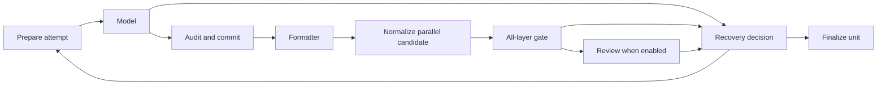
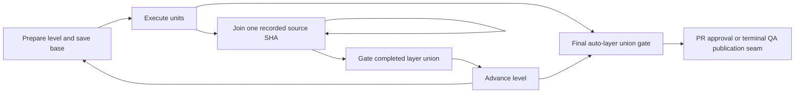

# Version-2 run inputs and migration

Heavy-PRD remediation is still in progress. This documents completed runtime
slices through S10, not a readiness release. The [implementation checklist](reviews/heavy-prd-progress.md) and
[acceptance record](reviews/heavy-prd-evidence.md) identify the remaining work and
unrun live gates.

## Preflight and selected source

Before constructing the model executor, the CLI validates the execution contract,
required local host tools (`git`, `gh`, `claude`), Git identity, source commit,
committed `blacksmith.toml`, required auto-layer command strings and writable run
storage. A dirty tracked checkout is refused: commit or stash it first. Ignored
local PRDs and unrelated untracked files are allowed. Offline `blacksmith validate`
does not invoke Git, the SDK, or the network.

Repository identity includes the remote host and full owner/repository path.
Equivalent SSH and HTTPS forms match; a bare `owner/repo` PRD target denotes GitHub.
Other hosts can be expressed as a full remote URL. Credential-bearing origin URLs
are refused; use Git's credential helper instead.

The CLI prints the exact committed HEAD selected for the run. It persists the full
original PRD bytes, including CRLF line endings, normalized execution configuration,
trusted toolchain text, their SHA-256 hashes and the source identity. Only credential
environment-variable names belong in the configuration snapshot; their values are
not read into it.

A read-only local planning clone has its own Git metadata and no hard links to the
source. Planner and critic reads and index tools use this clone. The implementation
workspace is cut from that same commit after approval, even if the original branch
advances, its PRD is removed, or the runtime config changes during approval. Each
parallel worker gets its own run-owned clone. The original checkout is not modified.

Clones isolate Git state and guarded file writes. They are not OS sandboxes;
authoritative generated tests execute on the host. Native commands now have bounded
execution and toolchain credential filtering, described below. Unit, joined-level and final gates now record exact-candidate evidence for the
required layer unions. General use on untrusted repositories is not
established by these offline tests.

## Paths and ownership

`target.repo_path`, the checkpointer/store/metrics/live database paths, and the
transcript directory resolve relative to the runtime config file's directory.
Absolute paths retain their meaning and are stored canonically. Without an explicit
target, the repository containing the config directory is selected. A nested caller's
working directory does not redirect storage or the target.

For example, a config at `/project/ops/blacksmith.config.toml` with
`repo_path = ".."` selects `/project`; the default checkpoint database is under
`/project/ops/.blacksmith/`, including when invoked from `/project/src/`.

Each fresh run has a UUID and these paths under the config directory:

```text
.blacksmith/runs/<run-id>/
  manifest.json
  input.prd.md
  runtime-config.json
  trusted-blacksmith.toml
  operations.sqlite
  execution.lock
  commands/<operation-id>/{intent.json,stdout.log,stderr.log,outcome.json}
  fixes/<operation-id>.json
  gates/<operation-id>.json
  joins/<level>/{failure.txt,conflict.patch}
  plans/<sha256-of-raw-unit-id>.json
  plans/approval-proposal.json
  plans/approved.json
  planning/
  workspace/
  units/<sha256-of-raw-unit-id>/workspace/
```

Branches use `blacksmith/<run-id>/<unit-slug>-<unit-id-hash>`. IDs with the same
normalized slug remain distinct, and repeated unit IDs in different runs do not
collide. The old `branch_for` naming is for legacy callers and display only.

POSIX `flock` locks protect the full CLI drive/resume, including approval waits.
A thread lock prevents competing fresh invocations; a run lock also covers resumes
using another config file. A second owner exits before graph construction. Lock
files may remain on disk after exit; the kernel lock, not file existence, determines
ownership.

## Checkpointed plans and approval integrity

The production parent graph plans one auto unit per `plan` invocation, recording
`plans_by_unit_id`, an exact declaration-order prefix and `plan_cursor` after each
unit. Only after the complete auto-unit bundle exists does the single `approve_plan`
interrupt appear. Human QA has no model plan. The read-only planning snapshot and
full original PRD/contract remain the context for initial plans and bounded advisory
critic revisions. The static system prompt/repo map is checkpointed once and reused;
each invocation binds read/index tools to the same saved planning clone.

The CLI drives parent steps with synchronous checkpoint durability, so the next
unit cannot begin before the previous unit's checkpoint commits. Critic revisions
within a unit retain their deterministic S04 call identities and completed SDK
receipts: an interruption before the node checkpoint can reuse paid responses
without transport replay. A pending/uncertain SDK effect still refuses automatic
retry. This is not exactly-once provider billing or live cancellation evidence.

Each completed plan is atomically persisted under `plans/<unit-hash>.json`, bound
to run ID, unit ID and the immutable PRD hash, with its own content hash. Existing
artifacts cannot be overwritten with changed content. The plan approval proposal
is persisted before displaying the interrupt and includes the run ID, PRD hash,
bundle hash and per-unit hashes. Acceptance persists `approved.json` plus the same
hash binding in checkpoint state; a substituted plan cannot reuse the earlier bool.
Approval rejection does not create an approved artifact. Terminal reapproval still
requires S11; its artifact capture foundation is documented below.

Every implementation attempt (including continuation/fix/escalation/review revision)
and reviewer validates the whole approved bundle, selected plan and immutable
artifacts before admitting a model call. Missing/foreign/duplicate plans, mismatched
PRD/unit/cursor, changed steps/hashes or missing/corrupt proposal/approval evidence
halt. Full approval metadata and the selected plan cross both fan-out and child seed
boundaries. Resume validates existing plan evidence before executor construction.
Changing original source/config/PRD files during approval does not change the saved
inputs. Legacy direct-node callers without a run context retain their in-memory API;
that compatibility path is not the production approval contract.

A v2 checkpoint already holding old plans without `planning_version=1` refuses
execution with `legacy_planning_requires_manual_recovery` without rewriting paid
work, budgets or checkpoints. An old active workspace may first hit the stricter
S08 `legacy_unit_graph_requires_manual_recovery` guard. Runs interrupted before
any plans were checkpointed may enter the new planner and reuse completed journal
responses; uncertain responses still stop. Do not manufacture approval hashes for
an old run. Inspect retained history/artifacts until explicit S11 migration/recovery
is available, or start a new run with a new thread ID.

## Critical operation receipts

Each version-2 run has a separate SQLite operation journal in WAL mode with
`synchronous=FULL`. It is not the LangGraph checkpointer, memory store, metrics DB
or live event sink. Missing/corrupt/mismatched journals stop execution before an
executor is constructed on resume; a missing journal is never recreated as a new
empty run. Receipt writes fail closed.

Operation IDs hash the tuple `(run_id, unit_id, attempt_id, operation_kind)`.
Intent commits before the effect; its outcome and cost events commit atomically
afterward. Repeating an identical receipt/event is idempotent. Conflicting intent,
outcome or event content is an integrity error, preserving the original receipt.

Planning snapshot creation, version-2 SDK calls and implementation commits use
these receipts. SDK roles include planner, critic, initial/escalated implementer,
review-panel seats and PR summary. A completed SDK response can be reused after a
checkpoint interruption without calling the provider again. Missing terminal
results, lost streams and cancellation remain explicit uncertain outcomes;
automatic replay refuses them with `interrupted_attempt_requires_resume`.
Known streamed turns and reported terminal usage survive stream errors.

Implementation commits carry `Blacksmith-Operation-Id: <id>` trailers. Completed
commit reuse requires the recorded HEAD, a matching trailer and a clean workspace;
unknown extra changes stop for inspection. Matching committed effects now have
S11 reconciliation; other interrupted stages remain in progress. Native commands now record individual
intent/outcome receipts. Completed formatter receipts can reuse an already amended, clean owned candidate.
Interrupted formatter/squash/join/publication reconciliation and full artifact recovery
remain later slices; a command receipt alone does not make an
interrupted multi-command stage safe to repeat.

Cost events use call IDs and keyed reduction so a replayed update cannot add the
same call twice. Missing costs remain unknown, not measured zero-dollar calls.
Run-wide reservation admission and conservative budget charging are S15 work;
the journal alone is not a spending limit or an exactly-once billing guarantee.
`completed` means the recorded effect completed, not that a review approved a
candidate or all acceptance requirements passed.

SDK native tool sets are explicit: planner/critic/reviewer get read-only tools;
the implementer gets guarded file tools. Summaries have no native or MCP tools.
Installed SDK option/CLI-argument construction was checked locally; no live SDK
permission canary has run.

## Bounded native commands

`[limits].command_timeout_s` defaults to 1800 seconds for setup, fix, test, lint and
optional SBFL commands. Git and gh have a separate 120-second default; internal
callers can supply a command-specific deadline. `[limits].max_command_output_bytes`
defaults to 1048576 bytes, shared by each command's stdout and stderr log files.
The immutable saved settings apply to sequential workers, parallel workers and
resume. These limits add no model calls and do not replace run-wide admission.

Each command starts in a new POSIX session with closed stdin. Timeout or cancellation
sends TERM to its process group, allows up to five seconds for termination, then
sends KILL and reaps the direct child. Background descendants in the same group are
terminated even if the shell exits first. This is process-group ownership, not a
security boundary against hostile programs which deliberately escape their group.
Docker exec requires separate in-container ownership/termination evidence in S17.

Output is drained incrementally into capped files. Logs retain emitted byte counts
and explicit truncation metadata/markers; graph feedback includes bounded tails and
the retained command-log directory. Git outputs used for identity, paths or other decisions must
be complete, so truncation fails closed. Sensitive Git config/remote/identity output
is available only to its caller; persisted argv/output are redacted. Pre-context
preflight reads use bounded temporary log directories; once run identity exists,
logs and journal receipts are inside its run directory.

Toolchain children receive a copied environment with known model/admin/GitHub
credentials and the configured API credential variables removed. Authorized Git/gh
publication commands retain their normal credential access. Host files, credential
helpers and the network are not isolated: trusted host gates are not OS sandboxes.

Command IDs use transactionally allocated ordinals inside the run/unit/attempt/stage
identity. Observations always run again when requested; a previous HEAD/status result
is never reused as current truth. Critical intent persistence precedes spawning, and
outcome persistence follows process cleanup. An uncertain outcome stays available
for its owning stage to reconcile. Native commands are never automatically retried
by this service. Failed add, amend, reset, clean, squash and other required Git
operations stop execution rather than silently accepting incomplete work.

## Shared checkpointed unit execution

The parent graph ingests/plans/approves, creates the shared workspace, schedules
units, consumes outcomes, joins levels and reaches approval/publication/cleanup.
Both a sequential unit and a parallel worker invoke the same compiled child graph:



The recovery decision chooses bounded partial continuation, same-model fix, one
stronger-model escalation, bounded review revision or termination. It uses one
policy for both shapes, including optional SBFL before a checked reset. There is
no Python worker recovery loop. The existing strict review-policy hardening is
still S12 work; exhausted blocking review currently retains the legacy reporting
behavior and is not a release-readiness claim.

A successful model result, its pending commit metadata and cost events checkpoint
before audit/commit. Each next step checkpoints before another model call. Child
execution inherits the parent's SQLite saver and uses sync durability when that
checkpointer exists. LangGraph isolates child checkpoints under each parent task
namespace; each child stores `unit_namespace = <run-id>/<unit-id-hash>` so the durable
namespace maps unambiguously to its run/unit. Ordinary restart resumes the saved
child stage; it does not call the model or clone the workspace again. A standalone
legacy helper without a checkpointer keeps its nonpersistent API behavior.

Parent outcomes are typed and keyed by unit ID. Identical replay is idempotent;
conflicting terminal outcomes require explicit recovery. A keyed list view retains
the existing per-unit reporting API. Cost, finding and error events use stable IDs
so replay cannot append the same event twice. Dependency completion records are
passed separately from the child's local output ledger.

Parallel workers retain the single-commit join interface. When revisions create
multiple commits, checked normalization records a critical squash intent/outcome,
preserves the tree and operation trailer, and occurs before the authoritative gate
and review. A completed squash can be reused after losing its node checkpoint;
uncertain squash intent stops for S11 reconciliation. Sequential history is retained.
S10 now validates and integrates these recorded sources as described below. S11
artifact capture is present; complete failed-stage recovery remains in progress.

Optional unit-stage events carry run/unit/attempt IDs and forward through the
parent's writer, preserving CLI phase progress. Observation failure cannot replace
or bypass critical checkpoint/receipt persistence. Full telemetry/transcript honesty
remains S19 work.

Active version-2 checkpoints created before this topology and already owning a
workspace require manual recovery: resume emits
`legacy_unit_graph_requires_manual_recovery` before constructing an executor and
keeps the checkpoint/artifacts. New workspace preparation records
`unit_graph_version = 1`; pre-workspace approval checkpoints can enter the new
execution graph. Historical runs remain inspectable. No recovery path silently
resets consumed budgets or replays ambiguous paid work.

## Exact-source joins and integration gates

The parent now prepares each level before dispatch, records its clean shared base
SHA in checkpoint state and the critical `join.prepare` receipt, and performs one
join pick per checkpointed `join_level` invocation. Missing/foreign/duplicate or
wrong-level outcomes stop before picks. Each expected auto unit must have one
successful keyed outcome. Workers must be clean, own the run/unit branch/path,
contain exactly one normalized commit on the saved base and have a matching critical
unit-gate receipt and intact artifacts. Identical keyed replay is idempotent;
conflicting terminal outcomes are refused by the reducer.



Fetch uses the recorded source SHA, rather than the current branch tip. A critical
`join.pick` intent records source/base/destination parent before effects; a separate
`join.commit` intent records the staged tree before checked commit. The destination
message carries its operation ID and source SHA. Post-commit tree, cleanliness,
policy and operation/source trailers are checked before completion. The checkpoint
stores each source-to-destination mapping, parent and tree. Final verification checks
those mappings against both critical receipts and actual reachable Git objects.
Sequential units' historical receipts are validated against their original immutable
Git objects; they are not reused as gates for a later shared HEAD.

If a process exits after a pick or Git commit but before the outcome/checkpoint,
resume reconciles the exact clean HEAD, parent, staged-tree intent, source and
operation trailer, reuses the existing commit and continues at the next pick. An
unknown extra commit, dirty workspace, missing/corrupt evidence or uncommitted
interrupted pick stops for explicit recovery. Failed receipts are immutable; S11
must record an explicit recovery generation instead of overwriting one or resetting
consumed budgets. This does not prove live model billing/cancellation behavior.

A conflict, failed fetch (including a bounded-command exception), failed commit or
changed commit hook writes retained failure/conflict evidence, then uses checked
abort/reset to restore the whole saved level base. It retains every worker and the
shared workspace. A rollback error preserves both its own cause and the original
failure and does not retry/reset again. Unknown extra edits are retained for
inspection instead of being discarded. HALTED/rejected cleanup now preserves
workspaces/branches. S11 now captures manifests/binary/untracked snapshots/refs
bundles; explicit failed-stage recovery remains in progress.

After each multi-unit join, `integration_gate` runs the frozen toolchain over the
union of all auto layers completed so far. Before normal PR approval or the terminal
QA publication seam, `final_gate` checks all auto outcomes and gates the union of
all auto layers on the final clean candidate. Failures get fresh nonpassing scoped
receipts with command/artifact evidence, halt before approval/publication and never
retry an arbitrary last sibling. Approval and publication entry recheck complete
final evidence before summary/model or Git/gh effects. A halted run cannot pass these
guards under an old approval bool. Final and level commands remain deterministic;
these receipts prove the recorded commands, not the entire prose test contract.

New workspaces record `join_graph_version=1`. An active v2 workspace without that
marker refuses resume before executor construction with
`legacy_join_graph_requires_manual_recovery`; checkpoints/artifacts/budgets are
retained. Pre-workspace checkpoints with valid S09 plans may enter the new topology.
The QA seam still needs S13's exact-SHA PR approval, strict blocking/unavailable
review is S12 and publication reconciliation is S14. These gates are not a general
readiness or publication-safety release claim. No live release gate ran here.

## Unit attempt state and reset boundaries

`UnitAttemptState` owns the flat channels used by existing nodes and the shared
checkpointed unit subgraph: current unit, unit/attempt base commits, last passing SHA,
attempt ID/number, model tier, recovery counters, separate gate/review/continuation
feedback, candidate/evidence, error/resume flags and current review findings.
`BlacksmithState` inherits these fields; run-wide costs, historical findings, errors
and completed-unit records remain separate ledgers.

One pure `new_unit_attempt` factory initializes the first unit, sequential advances,
parallel worker entries and the next unit after a join. It uses the current combined
Git tip for a new unit, starts the initial model with zero counters, and clears all
candidate/test/formatter/review evidence and transient feedback. It does not copy
another unit's state or clear historical run ledgers.

`next_attempt` advances only the same unit. It invalidates old candidate evidence,
retains the unit base and relevant reviewer request, assigns a new deterministic
call identity and forwards the latest gate output to escalation even when no cheap
fix retry ran. Gate recovery after a failed review revision resets to that unit's
last passing candidate. Continuation keeps partial work and passes its instructions
in a separate feedback field; it does not reset the workspace.

Attempt identities retain the existing `(fix count, escalated, revision count,
continuation count)` encoding, so receipt keys and consumed counters are not reset
by a metadata addition or an ordinary restart. Older projections lacking a known
unit-base field retain `None`; no historical SHA is invented. Complete ambiguous
stage/boundary reconciliation remains S11 work. The factory runs at actual new-unit
transitions, not merely because `resume` was invoked.

Real CLI/checkpointer tests cover an escalated and reviewed sequential unit, then
parallel siblings, then a fresh sequential unit, including a stop after the join
and resume before its model call. The final unit starts cheap with no stale flags,
receives its own review, and resumes the same attempt identity. Both scheduling shapes now use the common compiled unit subgraph. The review-receipt channel starts absent; strict actual-patch review
receipts are S12 work. These state tests do not prove integration/publication or
killed-SDK recovery/billing safety.

## Trusted exact-candidate unit gates

Version-2 production uses the immutable preflight toolchain, including its exact text
hash, rather than reloading the implementation clone's `blacksmith.toml`. Each unit
runs every distinct declared auto layer in declaration order. Identical resolved
command tuples may run once, with all covered layers recorded. The first failing
tuple stops execution; remaining unexecuted layers/commands are explicitly `not_run`.

A typed `GateReceipt` binds run/scope/attempt, candidate commit and tree, trusted
config hash, ordered layers and coverage, actual commands/exit codes/timestamps,
output artifact paths/hashes, diagnostic and `passed|failed|error|timeout|dirty`.
Its JSON artifact and critical journal outcome must persist before success returns.
The checkpointer explicitly permits the new receipt types. Unit results/worker
outcomes retain their own receipts rather than relying solely on the latest channel.

Setup/test/lint must leave HEAD, tree, index and nonignored source clean. Ignored
build/dependency output is permitted. Mutation returns `dirty`, even when the command
exits zero. Exceptions produce fresh nonpassing evidence; errors/timeouts/dirty
results halt before retry/review/publication routing can use old passing state.
Ordinary test failures use the shared bounded unit recovery policy.
Per-command output is capped and multi-layer graph feedback has a 32 KiB aggregate
tail, with complete links to the retained capped command artifacts.

Reuse checks current HEAD/tree, source cleanliness, run identity, required layer
order, trusted config hash, critical journal outcome, receipt JSON and hashes of
command stdout/stderr/outcome artifacts. A changed candidate, layer set, missing or
corrupt artifact cannot reuse a passing receipt. `verify_gate_receipt` is the common
primitive for S10 join/final/publication entry guards. Exact-SHA approval payloads
and approval/publication reconciliation remain S13-S14.

Formatters require this attempt's completed implementation-commit receipt and
operation trailer. They cannot amend a prior unit when the implementer produced
no commit. Every required distinct formatter uses the frozen config, is audited
before checked staging/amend, and must leave a clean owned commit. A nonzero exit
may proceed only with unchanged HEAD and no tracked/index/nonignored source edits;
its failed command remains visible in a `clean_failure` formatter receipt. Partial
failed edits, protected-path edits, Git/staging/amend errors and timeout halt with
nonpassing gate evidence. Completed formatter receipts reconcile the amended SHA
without another amend; uncertain pending stages still require S11 recovery.

This proves unit verifier integrity for the recorded commands. It does not prove
the full natural-language test contract, honest patch review or publication approval.
S10 adds merged/final coverage; S11-S19 and live release gates remain open.

## Recovery artifact foundation (S11 in progress)

S11 is not complete. The implemented foundation captures retained evidence and
reconciles an observed implementation commit; explicit failed-stage recovery,
continuation amendments and budget additions are still being implemented. Do not
interpret this section as a recovery acceptance or general readiness release.

Fresh version-2 runs initialize a critical `recovery/index.json` before planning.
Run verification and production call contexts validate its run/context identity,
critical ownership receipts, immutable snapshot manifests and every recorded file
hash. Missing/corrupt indexes, malformed schemas, missing entries or changed
snapshots stop before a new model call. Removing recovery metadata while waiting
for plan approval blocks workspace preparation. Old active runs lacking this data
receive diagnostics without manufacturing a replacement or resetting paid work.

After preflight, the CLI protects the drive under the original run lock. On HALTED,
rejection or an exception (including cancellation/KeyboardInterrupt), it writes a
new private snapshot and prints its absolute recovery manifest path. Failed capture
is critical: partial files and its pending receipt remain, it reports the failure
and no later effect is scheduled. Earlier preflight failures retain the original run
directory/input manifest/journal but do not yet have a complete recovery capture;
explicit inspection/repair of those cases is part of remaining S11 work.

A completed snapshot includes:

- Full staged and unstaged binary patches (Git writes explicit owned files, so
  patch size is not silently limited by the command stdout cap).
- Nonignored untracked files and symlink target metadata, with no following of
  escape links; the complete original workspace remains retained.
- A refs bundle, including orphaned operation commits preserved from reflogs.
- Latest root and unit checkpoint state, with registered serializer types, original
  failure stages and consumed unit counters.
- Original input/config/toolchain manifests, plans, gate/fix/join artifacts,
  command logs and a consistent SQLite backup of model/operation receipts.

Files and directory entries are flushed before atomic manifest/index publication;
a completed capture has a matching critical journal receipt. Every older snapshot
stays immutable. Versioned runs now retain successful workspaces too. There is no
automatic deletion or garbage collection. Inspection reports the retained paths,
per-snapshot/total bytes and uncertain call IDs so the disk cost stays visible.

Inspect without loading credentials, constructing an executor or modifying the
checkpoint database, workspaces or artifacts:

```sh
blacksmith recovery inspect --thread-id my-run --config /path/to/blacksmith.config.toml
```

Inspection uses a SQLite read-only connection. Supply the original config selection
when it was explicit. Missing/corrupt evidence produces a diagnostic; it is not
silently regenerated. The currently printed next action is inspection; a full
failed-stage recovery CLI and contextual command reporting remain S11 work.

An SDK call killed without terminal evidence remains uncertain. Ordinary resume
refuses it with `interrupted_attempt_requires_resume`, preserving partial binary
and untracked files in a capture and leaving the original model receipt unchanged.
Explicit continuation under the remaining continuation budget is not implemented
by this foundation. Likewise a terminal rejection does not yet schedule a new
approval interrupt, and ordinary resume cannot restore a terminal failed stage.

Implementation commits now persist staged-tree intent before the Git commit. If
a process exits after committing but before outcome/checkpoint, resume verifies
clean exact HEAD, parent, tree and operation trailer, records reconciliation and
reuses the existing commit without another SDK/Git commit. A pending original
intent may complete. A failed/interrupted original receipt remains immutable;
a separate observed-effect proof establishes ownership for formatting. Unknown
extra changes or missing old tree evidence still require inspection. This is
observed Git-effect proof, not an exactly-once provider billing claim.

## Execution validation and archived PRDs

IDs, titles and module targets must be nonempty. Targets must be relative and cannot
traverse to a parent or name an absolute/Windows drive path. Hard path untouchables
follow the [authoring guide](prd-authoring-guide.md); a custom runtime config inside
the target is protected and included in the plan approval's hard rules.

An executable PRD may contain zero or one human QA unit. That unit must use only
human layers, be the sole terminal unit and transitively depend on every auto unit.
Human-only PRDs, human siblings, mixed auto/human units and mid-DAG human units are
invalid. Structural Contract-v1 parsing remains available for archived documents;
the historical v0 PRD is readable but does not satisfy today's execution semantics.

## Resume and checkpoint migration

New runs carry `state_version = 2`. Resume validates the recorded run context,
manifest and input hashes, selected source identity, planning clone and any recorded
workspace before constructing an executor. Missing/corrupt files stop with a recovery
diagnostic and no model call. Saved model, limit, toolchain and target settings are
authoritative; changing the local config does not silently replace them on resume.

Only real pending approval interrupts receive `Command(resume=...)`. An ordinary
interrupted node is driven with `None`. SDK response reuse and uncertain-call
refusal are in place. Artifact capture and implementation-commit reconciliation
are present; complete terminal-stage recovery remains S11 work. These slices do not establish exactly-once
billing across a killed provider process or recovery of terminal policy/gate failures.

Pre-migration checkpoints remain readable through the checkpointer and existing
history tools. Execution-resume refuses them with
`legacy_checkpoint_requires_manual_recovery`, without deleting or rewriting their
records. Fresh runs also refuse an existing thread ID; select a new `--thread-id`.
If an older nested invocation stored databases elsewhere, explicitly select those
paths for inspection rather than assuming they moved with the new path semantics.

No live canary, real push/PR creation or Docker recovery smoke is part of this
implementation proof. Those gates require separate authorization.
